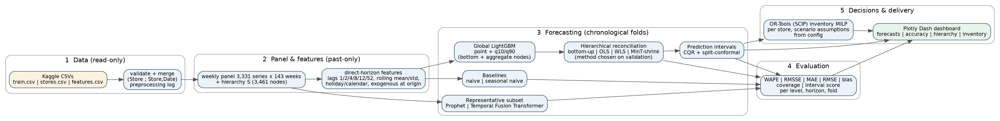

# Walmart weekly demand forecasting, hierarchical reconciliation and inventory planning

Chronologically validated weekly forecasts for Kaggle's **Walmart Store Sales Forecasting** data
(3,331 store-department series, 143 weeks), reconciled across a Total / Group / Store / Department / Store-Department hierarchy,
with prediction intervals, an OR-Tools inventory optimiser and a Plotly Dash dashboard.



## Quick start
```bash
pip install -r requirements.txt
python scripts/download_data.py          # or place train/stores/features.csv in data/raw/ (Kaggle link below)
make all                                  # prepare -> eda -> forecast -> representative (Prophet, TFT) -> inventory -> report
make test                                 # 44 automated tests
make dashboard                            # http://localhost:8050
```
Dataset: https://www.kaggle.com/competitions/walmart-recruiting-store-sales-forecasting/data
Individual stages: `python -m walmartfc.pipeline {prepare|eda|forecast|representative|inventory}`. All settings live in `config/default.yaml`.
Reference runtime on 1 CPU core: forecast stage about 15 min, Prophet + TFT about 30 min, inventory about 5 min.

## What is implemented
| requirement | where |
|---|---|
| Merge train/stores/features on correct keys, documented preprocessing, raw files untouched | `data/preprocess.py`, `reports/results/preprocessing_log.md` |
| Weekly `Weekly_Sales` target in dollars (no global target normalisation) | `features.py`, `models/lgbm.py` |
| Lags 1/2/4/8/12/52, past-only rolling mean/volatility, holiday, weather, fuel, markdown, CPI, unemployment, type/size/department | `features.py` |
| Naive, seasonal-naive, Prophet, LightGBM baselines; TFT on representative series | `baselines.py`, `models/lgbm.py`, `representative.py` |
| Hierarchical reconciliation (bottom-up, OLS, WLS, MinT-shrink) | `panel.py`, `reconcile.py`, `forecasting.py` |
| Probabilistic forecasts, conformal / CQR intervals, coverage reporting | `intervals.py`, `forecasting.py` |
| OR-Tools inventory optimisation, configurable assumptions | `inventory.py`, `config/default.yaml` |
| Dash dashboard: forecasts, accuracy, hierarchy, inventory | `dashboard/` |
| WAPE, RMSSE, MAE, RMSE, chronological validation | `metrics.py`, `splits.py` |
| Tests (leakage, splits, metrics, reconciliation, intervals, inventory, dashboard) | `tests/` |

## Important honesty notes
* **No state in the data.** `stores.csv` has only Type and Size. The Group level is store Type (A/B/C) and is labelled a state proxy. Provide
  `config/store_state_mapping.csv` (`Store,State`; template in `config/`) to switch the level to real states.
* **No item-level forecasts** are produced; the data has no item identifiers.
* **Inventory inputs are assumptions** (opening stock, lead time, ordering/holding/stockout cost, capacity) set in the config; Walmart's files contain none of them.
  The optimiser is a decision-support demonstration in sales-dollar units, not a claim about Walmart's economics.
* Results, including unflattering ones, are in `docs/results.md` (generated from saved artifacts). Read `docs/findings.md` before using any number.

## Docs
`docs/methodology.md` (design and protocol), `docs/notebook_review.md` (why the reference notebook was not reused as-is),
`docs/eda.md`, `docs/findings.md`, `docs/results.md`, `docs/architecture.png`, `presentation/` (10-minute deck + speaker notes).
